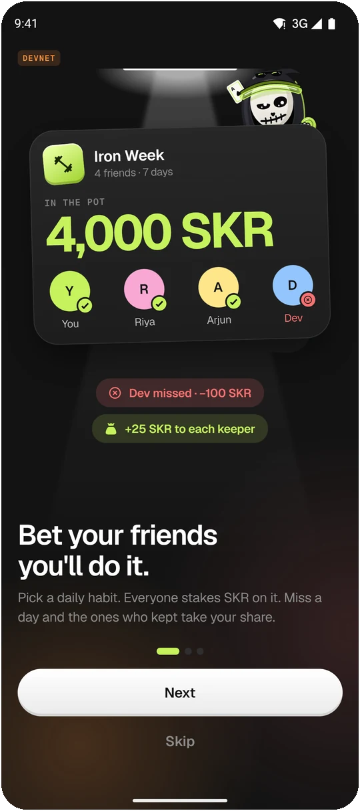
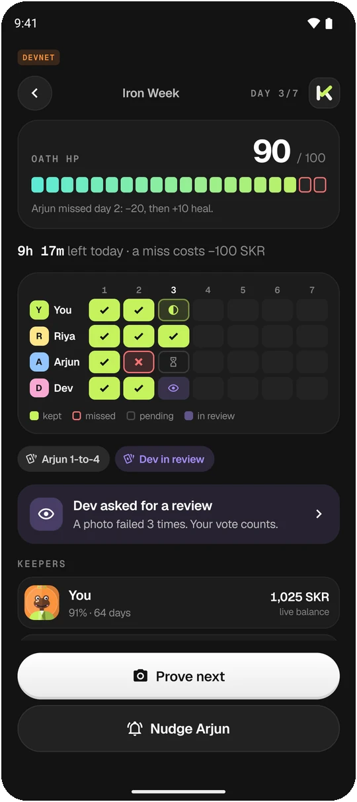
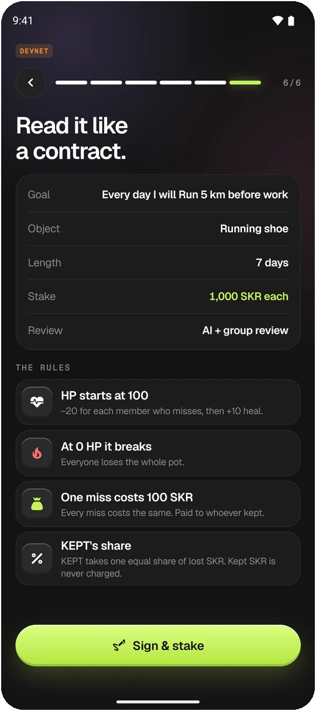
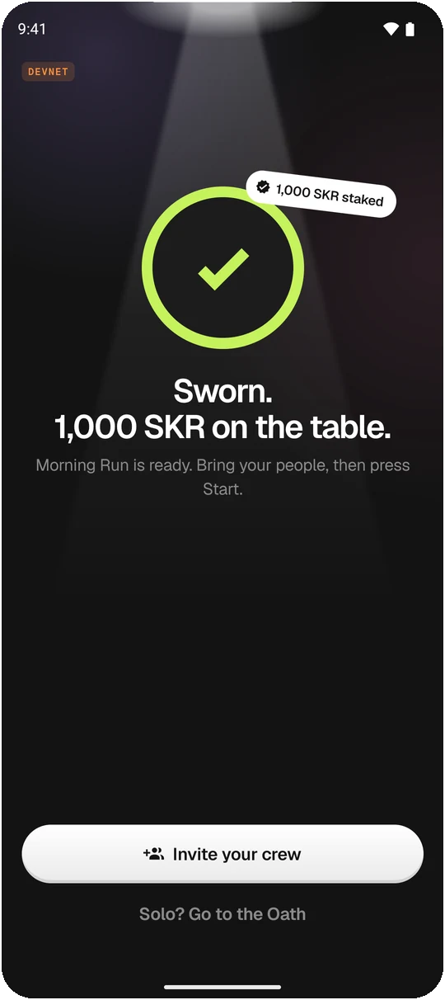
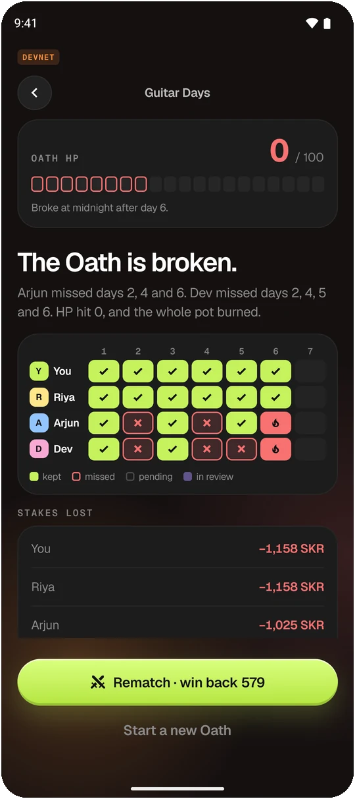
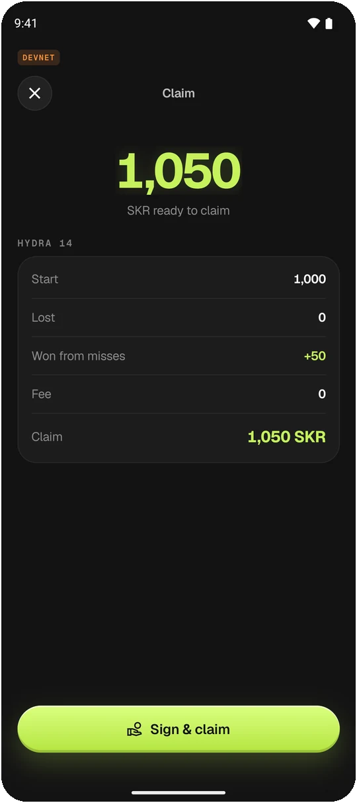
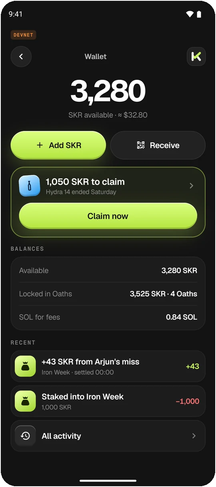
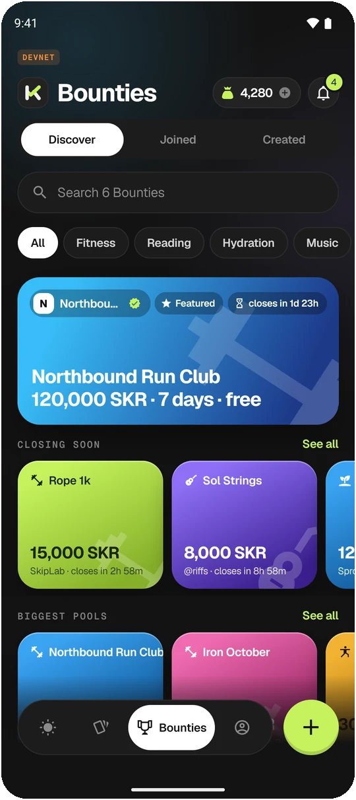
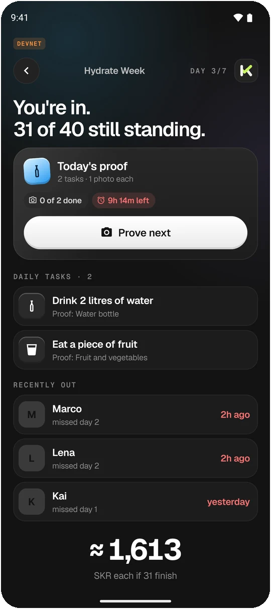
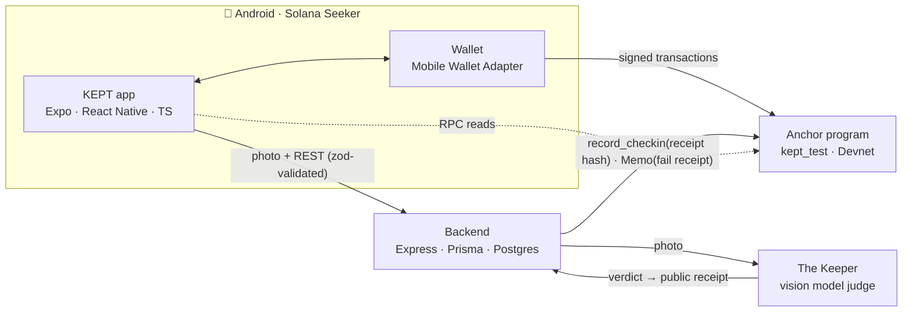

<p align="center">
  
</p>

<p align="center">
  <a href="https://github.com/ekanshvcpkg/KEPT-DAPP/releases/latest/download/KEPT.apk"></a>
</p>

<p align="center">
  <a href="https://github.com/ekanshvcpkg/KEPT-DAPP/releases/latest"></a>
  <a href="https://github.com/ekanshvcpkg/KEPT-DAPP/actions/workflows/ci.yml"></a>
  <a href="https://github.com/ekanshvcpkg/KEPT-DAPP/actions/workflows/release.yml"></a>
  
  
  
  
</p>

<p align="center">
  <a href="#-what-is-kept">What is KEPT</a> ·
  <a href="#-screenshots">Screenshots</a> ·
  <a href="#-download-and-try-it">Download</a> ·
  <a href="#-how-it-works">How it works</a> ·
  <a href="#-architecture">Architecture</a> ·
  <a href="#-development">Development</a> ·
  <a href="#-releases">Releases</a>
</p>

---

## 🔥 What is KEPT

**KEPT** is an Android app for the **Solana Seeker** that turns habits into commitments with real stakes.

You swear an **Oath** (a daily habit, alone or with friends), stake **SOL** on it, and prove each habit every day with a **live photo** of the habit's object and a hand gesture drawn from a recent Solana blockhash. **The Keeper**, an AI judge on the server, checks every photo and writes a receipt; the receipt's hash goes on chain with the kept day, and a failed check is published in an SPL Memo, so anyone can audit a verdict. Keep your word and you get paid; miss a day and the ones who kept take your share.

> **Habit apps trust your word. Crypto habit apps trust your phone. KEPT trusts neither.**

- 🤝 **Oaths.** Solo or group, 3, 7 or 14 days, stakes escrowed by an Anchor program on Solana.
- ❤️ **Oath HP.** Every Oath shares one health bar. Misses hurt it, kept days heal it, and at 0 the Oath breaks.
- 🔁 **Rematch.** Win back half of a broken Oath by keeping every day of a new one.
- 🏆 **Bounties.** Free public challenges funded by a sponsor, with several daily tasks; survivors split the pool.
- 📈 **Kept rate.** A public trust score: how reliably you keep your word.
- 💀 **The Keeper.** A half-warden, half-bookie reaper who holds the pot, judges proof and has opinions.

## 🏁 Hackathon: what existed before, what we built during

**Before the hackathon (inherited, by the original author, 2026-10-09 → 2026-11-16, up to commit `afb1f0c` "Release v1.2.0"):** the Expo app and its 116 designed screens, Demo mode, the Oath/HP/escrow rules engine, the Anchor program source, the Express backend, Mobile Wallet Adapter sign-in. Its Live mode could not create an Oath on the deployed program, and Live proofs trusted the phone's own verdict (see [`docs/notes/AUDIT_2026-11-26.md`](docs/notes/AUDIT_2026-11-26.md)).

**During the hackathon (our team, from 2026-11-26, commit `31649d4` onward, branch `hackathon`):**

| What | Where |
|---|---|
| Our own program instance on Devnet (new id, a separate verifier key that cannot upgrade, our mint and treasury) and an end-to-end escrow proof | `31649d4`, `4359a65`, [`onchain/scripts/e2e_devnet_sol.ts`](onchain/scripts/e2e_devnet_sol.ts) |
| **The Keeper**: server-side AI judge of proof photos, public receipts, receipt hash recorded on chain, failed verdicts in an SPL Memo, blockhash-derived challenges | `8e192fe`, `d7eb915`, `68eb39d`, [`backend/src/v4/keeper.ts`](backend/src/v4/keeper.ts) |
| **Audit the Keeper** in the app: re-hash receipts on the phone and compare with the chain | `c966cf2`, [`frontend/src/features/keeper/audit.ts`](frontend/src/features/keeper/audit.ts) |
| Live without the 2.6 GB on-device model download; honest Live (Bounty join hidden until proof works) | `c966cf2`, `e4698bf` |
| Phantom fix (no silent re-authorization for an unverified identity) and the first full Live run on a phone | `995f76b`, [`docs/notes/app-devnet-run-2026-11-26.md`](docs/notes/app-devnet-run-2026-11-26.md) |
| **Explain before sign**: the signing screen decodes the transaction with the program IDL and simulates it, shows what it does and exactly how much SOL leaves the wallet, and opens the wallet only on "Open wallet to sign"; foreign instructions are flagged | `8aa94bb`, [`packages/chain/src/explain.ts`](packages/chain/src/explain.ts) |
| **The Keeper's voice** (ElevenLabs): the Keeper says its verdict after every photo check and reads each transaction aloud before you sign | `6c9cc5b`, [`backend/src/v4/voice.ts`](backend/src/v4/voice.ts), [`frontend/src/features/keeper/voice.ts`](frontend/src/features/keeper/voice.ts) |

`git log afb1f0c..hackathon` lists every change made during the hackathon.

## 🏆 Tracks

| Track | How KEPT qualifies |
|---|---|
| **Solana: Best App Overall** | Our Rust (Anchor) program `kept_test` on Devnet ([addresses](#-devnet-addresses-and-evidence)); native SOL escrow, shared HP, payouts by rules replayed on chain; Android app with Mobile Wallet Adapter; public repo, setup below. |
| **Solana: Agentic** | The Keeper is an AI agent with a wallet: the only key the program accepts for check-ins is the verifier the Keeper's server holds. Every verdict is verifiable AI: a receipt (photo hash, challenge, model, verdict) whose hash is on chain, re-checkable by anyone. Before any signature, the Keeper explains the transaction (IDL-decoded, simulated balance change) and flags anything that isn't KEPT. |
| **Solana Mobile** | Built for Android from the ground up: native camera proof, Mobile Wallet Adapter signing, Seeker-first design, APK release. |
| **ElevenLabs** | The Keeper speaks: verdicts on proof photos and plain-words transaction explanations before signing, through ElevenLabs text-to-speech (`eleven_flash_v2_5`) from the backend (the key never reaches the app), cached per line and capped per wallet. `scripts/keeper_voice_design.ts` designs a custom reaper voice with Voice Design on a paid plan; on the free plan a premade voice is used. |

## 📸 Screenshots

<table>
  <tr>
    <td align="center"><br><sub><b>Bet your friends</b></sub></td>
    <td align="center"><br><sub><b>Today</b>: what's due, what's won</sub></td>
    <td align="center"><br><sub><b>Oath HP</b> and the day grid</sub></td>
    <td align="center"><br><sub><b>Oaths</b>: active, waiting, finished</sub></td>
  </tr>
  <tr>
    <td align="center"><br><sub><b>Who's in</b> and what's on it</sub></td>
    <td align="center"><br><sub><b>Read it like a contract</b></sub></td>
    <td align="center"><br><sub><b>Sworn</b>: stake signed on chain</sub></td>
    <td align="center"><br><sub><b>Invite</b> by QR or link</sub></td>
  </tr>
  <tr>
    <td align="center"><br><sub><b>Broken</b> at 0 HP</sub></td>
    <td align="center"><br><sub><b>Rematch</b>: win back half</sub></td>
    <td align="center"><br><sub><b>Claim</b> your payout</sub></td>
    <td align="center"><br><sub><b>Wallet</b>: SKR, SOL, claims</sub></td>
  </tr>
  <tr>
    <td align="center"><br><sub><b>Bounties</b>: free public challenges</sub></td>
    <td align="center"><br><sub><b>Bounty</b>: a sponsor's daily tasks</sub></td>
    <td align="center"><br><sub><b>Prove every task</b>, one photo each</sub></td>
    <td align="center"><br><sub><b>Profile</b> and kept rate</sub></td>
  </tr>
</table>

<sub>Captured from the release APK in Demo mode.</sub>

## 📲 Download and try it

<a href="https://github.com/ekanshvcpkg/KEPT-DAPP/releases/latest/download/KEPT.apk"><b>⬇️ Download the latest KEPT.apk</b></a> (Android 7.0+, arm64: the Solana Seeker and any modern Android phone). Every version is on the [Releases](https://github.com/ekanshvcpkg/KEPT-DAPP/releases) page.

1. Open the link on your phone, or copy the APK over USB (`adb install -r KEPT.apk`).
2. Tap the file and allow **Install unknown apps** when Android asks.
3. Open **KEPT** → **Get started** → pick a mode.

| | 🎮 **Try the demo** (recommended) | 🔗 **Use my wallet** (Live) |
|---|---|---|
| What it is | A sample account on a simulated backend, wallet and program | The real app on Solana **Devnet** |
| Needs | Nothing. No wallet, no SKR, no network (works in airplane mode) | Any Mobile Wallet Adapter wallet (Seeker Wallet, Phantom, Solflare), devnet SOL |
| Signing | Simulated: signing screens say *"Demo: the approval is simulated."* | Real transactions in your wallet |
| Reset | Profile › Settings › **Restart demo** / **Exit demo** | Sign out returns to the start |

**Two-minute tour:** [`docs/DEMO_SCRIPT.md`](docs/DEMO_SCRIPT.md) walks through the core loop, including **Skip to tomorrow** (Profile › Settings), which settles a day so you can watch a miss cost HP and stake.

<details>
<summary><b>What is real in Live (Devnet)</b></summary>

<br>

| Real on Devnet | How |
|---|---|
| Sign-in | Sign-In With Solana message signed in your wallet, checked by the backend; Seeker Genesis Token check |
| Create, join, start, cancel, settle, claim an Oath | Transactions to the Anchor program `kept_test` ([`7VpBDwXiDvvaG29VBFUPankoSWFVanyD9KcT7wbmLVzj`](https://explorer.solana.com/address/7VpBDwXiDvvaG29VBFUPankoSWFVanyD9KcT7wbmLVzj?cluster=devnet)); native SOL stakes are escrowed in the Oath account. Settle is permissionless (the backend's scheduler or the app's Settle button). See [Devnet addresses](#-devnet-addresses-and-evidence) |
| Daily proof | The photo is uploaded and judged by **the Keeper** on the server (a vision model; the app's own verdict is ignored). The receipt's SHA-256 is recorded on chain by `record_checkin` (signed by the verifier key, which cannot upgrade the program); failed checks are published in an SPL Memo. Challenges are one-time, expire, and take their gesture from a recent blockhash. See [The Keeper keeps receipts](#-the-keeper-keeps-receipts) |
| Balances, test SKR | Read from RPC; the faucet sends test SKR once per wallet |
| Invites, nudges, inbox, kept rate | The backend (kept rate is the backend's plain kept / (kept + missed), "New" under 10 days) |
| Bounties | The backend's current Bounty: list and detail. Joining is hidden in Live until Bounty proof runs through the Keeper |

**Not in Live yet** (hidden or shown as unavailable, never faked): Rematch, creating a Bounty, Bounties with several tasks (Live's Bounty has one), swap, creator pages, group review of habit photos and proving a Bounty day. HP and cost-per-miss on Oath screens are computed in the app by [`packages/engine`](packages/engine). Oaths created since the rules v3 upgrade (2026-10-11) settle on chain by the same rules, tested against the same vectors (`packages/engine/test-vectors/oath-vectors.json`); Oaths created earlier keep the program's v1 rules. Addresses, transactions and what is and isn't verified: [`docs/SUBMISSION_EVIDENCE.md`](docs/SUBMISSION_EVIDENCE.md). Gaps: [`docs/BACKEND_GAPS.md`](docs/BACKEND_GAPS.md).

</details>

## 🎯 How it works

| | Rule |
|---|---|
| **Swear** | Name the Oath, add habits (each with its own proof object), pick 3, 7 or 14 days, solo or group, and a stake per person. Sign once; the stake goes into escrow. |
| **Prove** | Each habit, each day: one live photo of the object plus the hand gesture KEPT asks for (drawn from a recent Solana blockhash). Camera only, no gallery. Judged by the Keeper on the server, with a public receipt. |
| **HP** | Every Oath starts at 100 HP. At the end of each day: −20 per member who missed (−35 solo), then +10 heal, capped at 100. At 0 the Oath breaks. |
| **Miss** | A miss costs 10% of your stake, shared between that day's keepers and KEPT. |
| **Review** | Choose *AI only* or *AI + group review*: after 3 failed checks of a photo, the group votes. Group review runs in Demo only for now; in Live, 3 failed checks end the day as missed. |
| **Get paid** | When the Oath ends, claim what you kept plus what you won from others' misses. |
| **Rematch** | A broken Oath can be run back: keep every day of the Rematch and win back half of what you lost. Demo only for now: on chain, the held half goes to KEPT's treasury after 7 days until Rematch recovery is built. |
| **Bounties** | A sponsor funds the pool and sets the daily tasks (say: check in at the gym, bench press, push-ups, a protein shake), each with its own proof object. Joining is free; prove every task every day to stay in, and survivors split the pool. |

Product rules in full: [`design/rules.md`](design/rules.md), with amendments in [`docs/DECISIONS.md`](docs/DECISIONS.md).

## 🔍 The Keeper keeps receipts

Up to four friends share one HP bar, so a faked day takes money from the friends who were honest. KEPT's answer is a judge that can be checked:

1. **Challenge.** `POST /api/proof/challenge` derives the hand gesture from the latest Solana blockhash (`sha256(blockhash)[0] mod 3`, never the previous gesture) and records the slot, so the server can't pick it. It expires in two minutes, and the photo must answer that exact challenge.
2. **Judge.** The app uploads the photo to `POST /proof/verify`. The server hashes it, asks the vision model whether the object and the gesture are there and whether it is a photo of a screen or a printout, and **ignores any verdict the app sends**. A photo that already passed can't be reused.
3. **Receipt.** The verdict becomes a receipt (`wallet, oath, day, habit, photoSha256, challenge {gesture, slot, blockhash}, model, verdict, pass`). Its SHA-256 over canonical JSON is public at `GET /keeper/receipts/:hash`.
4. **On chain.** When every habit of the day has a passing receipt, the verifier key signs `record_checkin` with `proof_hash = sha256(receipt hashes in habit order)`. A failed check's receipt hash is published in an SPL Memo (`kept:fail:<hash>`) from the same key.
5. **Audit.** In the app, **Audit the Keeper** (on the "day kept" screen) fetches the receipts, re-hashes them on the phone, and compares the result with the `CheckinRecorded` event in the check-in transaction.

**Verify one yourself:** `GET /keeper/oaths/<oath>/days/<day>?wallet=<wallet>` returns the receipt hashes, their combined hash and the transaction signature. Hash each receipt from `/keeper/receipts/<hash>` (keys sorted, no whitespace), concatenate the hashes, SHA-256 them, and compare with `proof_hash` in the transaction's `CheckinRecorded` event.

**What this does and does not prove.** It proves which photo (by hash) was judged, against which challenge, by which model, with which verdict, and that the verdict the chain acted on is that one. It does not make the model infallible: a model false negative still costs a day (Live has no appeal yet), and the photo itself is not public. With only three gestures the challenge is not proof of freshness on its own: an identical photo can pass only once (any wallet), but a determined cheater with a stored photo per gesture and a modified client could re-encode it. The next step is a high-entropy challenge (a short code from the blockhash written next to the object) plus perceptual-hash deduplication.

## ⛓ Devnet addresses and evidence

| What | Address |
|---|---|
| Program `kept_test` | [`7VpBDwXiDvvaG29VBFUPankoSWFVanyD9KcT7wbmLVzj`](https://explorer.solana.com/address/7VpBDwXiDvvaG29VBFUPankoSWFVanyD9KcT7wbmLVzj?cluster=devnet) (upgrade authority `A7eD3kFxPTMa4SELVbYneJ7yTYPVhmH66Lb3i84wrcmA`) |
| Config PDA | [`BY6a5bNCuaVeSXD67GSVkjAwDKed1cthPTc2vZCtBpr6`](https://explorer.solana.com/address/BY6a5bNCuaVeSXD67GSVkjAwDKed1cthPTc2vZCtBpr6?cluster=devnet) |
| Verifier (the Keeper's key; can only record check-ins) | [`6tcCGfLheQD5Fq9c7W4jtStwA7WbpszNsvwTL9zJ3xcZ`](https://explorer.solana.com/address/6tcCGfLheQD5Fq9c7W4jtStwA7WbpszNsvwTL9zJ3xcZ?cluster=devnet) |
| Treasury wallet (native SOL fees) | [`BWsQ8zyb2RY1o1GJdGLo67EzpRYq5vUU8DiErXXJEJwP`](https://explorer.solana.com/address/BWsQ8zyb2RY1o1GJdGLo67EzpRYq5vUU8DiErXXJEJwP?cluster=devnet) |
| Treasury token account / test-SKR mint (Token-2022) | [`HSLLjdHi1oPpZKv99jigvSU4n7p1Jq1WJhVeoirAf6JM`](https://explorer.solana.com/address/HSLLjdHi1oPpZKv99jigvSU4n7p1Jq1WJhVeoirAf6JM?cluster=devnet) / [`CDGRQc6aj7r6Kk41gvzeH2ta7vzL5rAXeogLJm7nkSqu`](https://explorer.solana.com/address/CDGRQc6aj7r6Kk41gvzeH2ta7vzL5rAXeogLJm7nkSqu?cluster=devnet) |
| Legacy program (inherited codebase, older build) | `6iXXBqsdiCnUTSVf8CW3Uuw8c7iYvZSj5haz64QMuMUh` |

**Native SOL escrow, end to end** ([`onchain/scripts/e2e_devnet_sol.ts`](onchain/scripts/e2e_devnet_sol.ts), [log](docs/notes/e2e-devnet-sol-2026-11-26.log)): 3 members × 0.01 SOL, 3 two-minute days, member C misses day 2. Every payout matches the rules replay: A and B get 0.010333333 SOL, C gets 0.009 SOL, the treasury 0.000333334 SOL, and the totals conserve the 0.03 SOL staked.
[create](https://explorer.solana.com/tx/AqrCADh6mxktq9jzcHEYKNEyego7XYUeB2VawEMe9hJjQBYP6Gep7n8pL9vV5zJygPakuy1V36c2XuxunXCpqYt?cluster=devnet) ·
[join](https://explorer.solana.com/tx/YH9XDLNWex2KrCt6Q9w99yXm65nmGvf3nD9d11dkWBbciLaer9FKbZYwV4T8qrA8AyV9pwHb4v6AWDjzYKq4Sek?cluster=devnet) ·
[start](https://explorer.solana.com/tx/2sYisNM4ob2NSkHGSPaU4gopTb2863kuowWBsRKfPEidGgDGy9xBZMnUAEMwTQ3TfXv6kPTpnB8W36esrunEaPFr?cluster=devnet) ·
[check-ins day 2](https://explorer.solana.com/tx/37ePFceUDK1VutQCWWz8Ca9S56PyACLgPVRGk3XW2zZLWescU2zkB83aoxCUbwrhpb3SurHctScYhcZT4TSc1Xgn?cluster=devnet) ·
[settle](https://explorer.solana.com/tx/2usvhEzdt8ewESzQHYAQHsFiYBww5SCGKSmSsaSdsAaSRxV7b1LWb4D9JnfTvrJv1kUd111YNgSzkK1wUR5k8QmE?cluster=devnet) ·
[claim](https://explorer.solana.com/tx/2n6SvetZxqwhudxgrAK9Sx2mGXgdTBpaNS3TNXBP6raGpPfBXXg3M4rys7AKtKMs1AUg2TxEJhG7fcEnaBwdUonh?cluster=devnet)

**The Keeper pipeline** ([`backend/scripts/keeper_e2e_devnet.ts`](backend/scripts/keeper_e2e_devnet.ts), [log](docs/notes/keeper-e2e-devnet-2026-11-26.log); stand-in vision model): the audit's 3-call forgery is refused; a passing photo's receipt hash is what [`record_checkin`](https://explorer.solana.com/tx/5U1f84eZrkZBwEzKbcXaY9g9GiSdsrAd8DPZY1E6HaXsqMri3cMrPx9ZvCjmmbKpHJADuyhMxtGmuN2ncNq2nKjh?cluster=devnet) puts on chain; a photo of a screen is rejected and its receipt hash is published in an [SPL Memo](https://explorer.solana.com/tx/22kQ2Eq7Gp7MYN3kCSGXvewJZrNo3e16ZCVPJfcfkzE6RkSGS9x3yRMWMnrGK7K2xLaa8yvmjDZkGmyDYNvvpSuv?cluster=devnet).

**Known limits (Devnet build):** the program is built with `debug-tools`, which allows 2-minute days for demos (production uses 86,400 s); Seeker Genesis verification is mocked on Devnet with an allowlist (Genesis Tokens live on mainnet); Rematch recovery and on-chain Bounties are Demo-only; there is no `set_verifier` instruction yet. The full audit that drove these fixes is in [`docs/notes/AUDIT_2026-11-26.md`](docs/notes/AUDIT_2026-11-26.md).

## 🧱 Architecture



| Layer | Stack |
|---|---|
| **App** | Expo SDK 57 (development build), React Native 0.86 (New Architecture, Hermes), TypeScript strict, React Navigation, TanStack Query, Zustand, Zod, Reanimated 4, Skia, react-native-svg, expo-camera |
| **Wallet and chain** | Solana Mobile Wallet Adapter, `@solana/web3.js`, Anchor IDL client in [`packages/chain`](packages/chain) |
| **Rules engine** | Pure TypeScript in [`packages/engine`](packages/engine): HP, cost per miss, daily distribution, Rematch recovery, kept rate, odds, with JSON test vectors shared with the Rust tests |
| **The Keeper** | Server-side judge ([`backend/src/v4/keeper.ts`](backend/src/v4/keeper.ts)): any OpenAI-compatible vision model (OpenRouter by default), canonical-JSON receipts, SPL Memo for failures, blockhash-derived challenges. The app re-checks receipts against chain with [`packages/chain/src/keeper.ts`](packages/chain/src/keeper.ts) |
| **On-device AI (optional)** | A local Expo module ([`frontend/modules/kept-gesture`](frontend/modules/kept-gesture)) running MediaPipe gesture recognition and Gemma (LiteRT-LM); no longer required for Live proof |
| **Backend** | Express + Prisma + Postgres ([`backend/`](backend)) |
| **Program** | Anchor (Rust), [`onchain/programs/kept_test`](onchain) |
| **Design** | 116 screens, tokens, copy and motion from the design handoff in [`design/`](design); theme and strings are generated from it, never hardcoded |

### Repository layout

| Path | Layer | What |
|---|---|---|
| [`frontend/`](frontend) | UI | The Expo app (Android, Solana Seeker) |
| [`backend/`](backend) | Node backend | Express + Prisma backend (V4 Devnet prototype) |
| [`onchain/`](onchain) | On-chain (Rust) | Anchor program `kept_test` |
| [`packages/*`](packages) | Shared TS | config, engine, schemas, chain client |
| [`infra/`](infra) | Infra | `docker-compose.yml` (local Postgres) |
| [`design/`](design) | Design | The design handoff (read-only source of truth) |
| [`docs/`](docs) | Docs | Architecture, backend gaps, decisions, build plan, API; `docs/notes/` for session reports |
| [`legacy/`](legacy) | Reference | V3 Aura backend code, program tests and docs (not built) |
| [`patches/`](patches) | Tooling | pnpm dependency patches |

Each top-level folder has a `README.md` describing its contents.

## 🛠 Development

**Requirements:** Node ≥ 20, pnpm, Docker (local Postgres). For the app: Android Studio (SDK + platform tools, `ANDROID_HOME` set) and JDK 17. For the program: Rust, Solana CLI (Agave), Anchor 1.2.0.

### Backend

```bash
pnpm install
pnpm db:up                             # Postgres 16 on localhost:5432 (user/pass/db: kept)
cp backend/.env.example backend/.env   # then fill it in (see backend/.env.example)
pnpm --filter kept-backend exec prisma migrate deploy
pnpm api:dev                           # http://localhost:3000
```

The Keeper needs a vision model: set `OPEN_API_KEY` (an OpenRouter key by default; `VISION_API_URL` and `VISION_MODEL` point it at any OpenAI-compatible endpoint). Without it, photo checks answer `503 check_unavailable` and the app offers a retry.

**Your own program instance** (what this repo runs on Devnet): build and deploy `onchain/` (`pnpm program:build`, then `solana program deploy --program-id <program keypair> target/deploy/kept_test.so`), then initialize it with `ADMIN_KEYPAIR=<upgrade authority> VERIFIER_PUBKEY=<verifier> TREASURY_OWNER=<treasury wallet> KEEPER_PROGRAM_ID=<id> pnpm --filter kept-backend exec tsx scripts/v4-setup.ts` (it creates a test mint, the treasury account and the Config, and funds the treasury wallet to the rent-exempt minimum). Put the printed values and the verifier key in `backend/.env`.

**End-to-end checks on Devnet:** `cd onchain && npx tsx scripts/e2e_devnet_sol.ts` (escrow: create → join → check-ins → settle → claim, every payout checked) and `cd backend && npx tsx scripts/keeper_e2e_devnet.ts` (the Keeper: forgery refused, receipt hash on chain, failed verdict in a Memo).

### App on an Android phone

The app is a **development build** (Expo Go can't run the wallet adapter or the camera). On the phone, turn on **Developer options → USB debugging**.

```bash
pnpm install
adb devices                      # the phone must be listed as "device"
pnpm mobile:android              # prebuilds android/, builds and installs app.kept.mobile, starts Metro on 8082
```

After the first install you only need Metro: `pnpm mobile:start`, then open **KEPT** on the phone (same Wi-Fi, or `adb reverse tcp:8082 tcp:8082` over USB). Shake the phone (or `adb shell input keyevent 82`) for the dev menu.

**Demo and Live (D-80).** On first launch, **Get started** asks how to start:
- **Try the demo:** a sample account on the built-in mock. No wallet, no network, works in airplane mode. There is no DEMO badge on screen (owner, 2026-10-12); signing screens say the approval is simulated. Profile → Settings → **Restart demo** puts the account back the way it began; **Exit demo** wipes it and goes back to the start.
- **Use my wallet:** Live. Real wallet (MWA), real backend, real program, no mock data. Features the backend doesn't have yet are hidden; see [`docs/BACKEND_GAPS.md`](docs/BACKEND_GAPS.md). Signing out returns to the start, where the mode can be picked again.

"I have an invite" and `kept://join/<code>` links always use Live.

### Checks

```bash
pnpm typecheck
pnpm lint
pnpm test
pnpm program:build && pnpm program:test   # build the program first; its tests load target/idl
```

CI ([`.github/workflows/ci.yml`](.github/workflows/ci.yml)) runs typecheck, lint and tests for the app and packages on every push and pull request.

<details>
<summary><b>Live against your local API</b></summary>

<br>

1. Start the backend (above). In `backend/.env` put your phone wallet's address in `SGT_MOCK_ALLOWLIST` to get **A3 Seeker verified**; leave it out to see **A3·no**.
2. `cp frontend/.env.example frontend/.env` (`EXPO_PUBLIC_STAKE_MINT` is only a fallback: Live reads the stake mint from the program's Config account). The example points to the hosted Devnet API; to use the local API, set `EXPO_PUBLIC_API_URL=http://localhost:3000`.
3. `adb reverse tcp:8082 tcp:8082` for Metro, and `adb reverse tcp:3000 tcp:3000` for the local API.
4. Open KEPT → **Get started** → **Use my wallet** → pick a wallet row → approve the connect, then the sign-in message in your wallet.

</details>

<details>
<summary><b>Dev menu and deep links</b></summary>

<br>

In development builds, long-press the orange **DEVNET** badge. Override any slice to `http` or `mock`, pick a mock scenario (`judges`, `notEligible`, `walletRejected`, `offline`, `noSkr`, …), use the mock wallet in Live, move the virtual clock, jump to any of the 116 screens, open the component **Gallery**, or sign out.

Deep link test: `adb shell am start -a android.intent.action.VIEW -d "kept://join/IRON-7K2Q"`.

</details>

<details>
<summary><b>Testing the core loop</b></summary>

<br>

- **In Demo (fastest):** Today has Iron Week with a habit still to prove, Hydra 14 to claim, and a joined Bounty; Oaths → Guitar Days is broken with a Rematch offer. In a development build, Dev menu → **End day** / **To deadline** moves time: other members prove on their own and Oaths settle after their last day.
- **On Devnet (Live, two phones or two wallets):** both wallets need devnet SOL and SKR (`POST /api/faucet` gives 5,000 SKR once). Phone 1: + → Start an Oath → Group → Sign & stake → Invite (QR). Phone 2: + → Join with code → scan → Join & stake. Phone 1: Start. On chain a solo Oath has no stake (D-30).

</details>

<details>
<summary><b>Testing Rematch, review, Bounties, profiles, inbox and wallet</b></summary>

<br>

In Demo (or a development build with the mock scenario of your choice):
- **Rematch:** Oaths → Guitar Days → **Rematch · win back …** (R1) → Join → R3 lobby. Scenario `rematchActive` shows R·act; **End day** through its last day for R4 / L6.
- **Group review:** bell → **Review photo** (G1) → Approve or Reject. To ask for one: an "AI + group review" Oath → prove a habit → scenario `proofFail` three times → **Ask your group to review** (G2).
- **Bounties:** Bounties tab → any Bounty → **Join free** → H3; `bountyOut` → H4, `bountyJoined` → H5. **Created** → **Create a Bounty** (K1–K5).
- **Profiles, inbox, wallet:** Profile tab (I1, I4, I5, I7, I8, I9), the bell (N1), the balance chip (W1 → W2 → W3 swap / faucet, W4 receive).

</details>

## 🚀 Releases

Release APKs are built by GitHub Actions ([`.github/workflows/release.yml`](.github/workflows/release.yml)) and attached to a [GitHub Release](https://github.com/ekanshvcpkg/KEPT-DAPP/releases) with screenshots, install steps and a SHA-256 checksum.

```bash
git tag v0.2.0
git push origin v0.2.0           # builds the APK and publishes the release "KEPT v0.2.0"
```

You can also run it by hand: **Actions › Release APK › Run workflow**, enter a tag. The asset is always named `KEPT.apk`, so [`releases/latest/download/KEPT.apk`](https://github.com/ekanshvcpkg/KEPT-DAPP/releases/latest/download/KEPT.apk) serves the newest build. The version name comes from the tag and so does the version code (`v1.2.3` → 10203), so each release installs over the last.

<details>
<summary><b>Signing and build settings</b></summary>

<br>

- **Signing.** All four repository secrets are required: `ANDROID_KEYSTORE_BASE64`, `ANDROID_KEYSTORE_PASSWORD`, `ANDROID_KEY_ALIAS` and `ANDROID_KEY_PASSWORD` ([`frontend/plugins/withReleaseSigning.js`](frontend/plugins/withReleaseSigning.js)). Missing credentials stop the release before building. CI writes private signing files with owner-only permissions and removes them after the build, including on failure. Keep the same signing key: Android won't update an app signed with a different key.
- **Build settings.** Repository variables `EXPO_PUBLIC_API_URL`, `EXPO_PUBLIC_STAKE_MINT`, `EXPO_PUBLIC_RPC_URL` and `EXPO_PUBLIC_PROGRAM_ID` override the defaults in [`frontend/src/config/env.ts`](frontend/src/config/env.ts). Live native-SOL Oaths require `EXPO_PUBLIC_LIVE_NATIVE_SOL_OATHS=1`, which must stay off until the matching API and program are deployed and verified. By default Live uses the hosted Devnet API at `https://kepttestapp.onrender.com`; a release build pointing at `localhost` refuses Live with a message.
- **Local release build.**
  ```bash
  cd frontend/android && ./gradlew assembleRelease     # → app/build/outputs/apk/release/app-release.apk
  ```

</details>

## 📚 Docs

See [SECURITY.md](SECURITY.md) for secret scanning, the local commit hook, and credential storage.

| Doc | What |
|---|---|
| [`docs/ARCHITECTURE.md`](docs/ARCHITECTURE.md) | How the app, packages, backend and program fit together |
| [`docs/SUBMISSION_EVIDENCE.md`](docs/SUBMISSION_EVIDENCE.md) | For reviewers: build and test commands, Devnet addresses and transactions, what is verified, Demo vs Live |
| [`docs/DEMO_SCRIPT.md`](docs/DEMO_SCRIPT.md) | A two-minute walkthrough of the core loop (Demo, simulated) |
| [`docs/DECISIONS.md`](docs/DECISIONS.md) | Product and engineering decisions, rule amendments |
| [`docs/BACKEND_GAPS.md`](docs/BACKEND_GAPS.md) | What the backend and program still need to match the design |
| [`docs/API.md`](docs/API.md) | The backend API as it exists today, plus proposed routes |
| [`docs/BUILD_PLAN.md`](docs/BUILD_PLAN.md) | How the app was built, phase by phase |
| [`design/`](design) | The design handoff: screens, components, tokens, copy, motion, rules |

<p align="center">
  <br>
  <br>
  <sub><b>KEPT</b> · keep your word · built for the Solana Seeker</sub>
</p>
