<p align="center">
  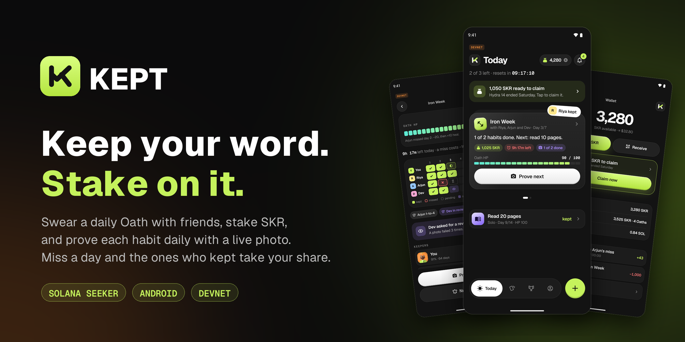
</p>

<p align="center">
  <a href="https://github.com/priyambuilds/Kept/releases/latest/download/KEPT.apk"></a>
</p>

<p align="center">
  <a href="https://github.com/priyambuilds/Kept/releases/latest"></a>
  <a href="https://github.com/priyambuilds/Kept/actions/workflows/ci.yml"></a>
  <a href="https://github.com/priyambuilds/Kept/actions/workflows/release.yml"></a>
  
  
  
  
</p>

<p align="center">
  <a href="#-what-is-kept">What is KEPT</a> ·
  <a href="#-screenshots">Screenshots</a> ·
  <a href="#-download-and-try-it">Download</a> ·
  <a href="#-how-it-works">How it works</a> ·
  <a href="#-architecture">Architecture</a> ·
  <a href="#-development">Development</a> ·
  <a href="#-releases">Releases</a>
</p>

---

## 🔥 What is KEPT

**KEPT** is an Android app for the **Solana Seeker** that turns habits into commitments with real stakes.

You swear an **Oath** (a daily habit, alone or with friends), stake **SKR** on it, and prove each habit every day with a **live photo**. An AI model running **on your phone** checks the photo for the habit's object and a hand gesture, so the photo never leaves the device. Keep your word and you get paid; miss a day and the ones who kept take your share.

- 🤝 **Oaths.** Solo or group, 3, 7 or 14 days, stakes escrowed by an Anchor program on Solana.
- ❤️ **Oath HP.** Every Oath shares one health bar. Misses hurt it, kept days heal it, and at 0 the Oath breaks.
- 🔁 **Rematch.** Win back half of a broken Oath by keeping every day of a new one.
- 🏆 **Bounties.** Free public challenges funded by a sponsor, with several daily tasks; survivors split the pool.
- 📈 **Kept rate.** A public trust score: how reliably you keep your word.
- 💀 **The Keeper.** A half-warden, half-bookie reaper who holds the pot, judges proof and has opinions.

## 📸 Screenshots

<table>
  <tr>
    <td align="center">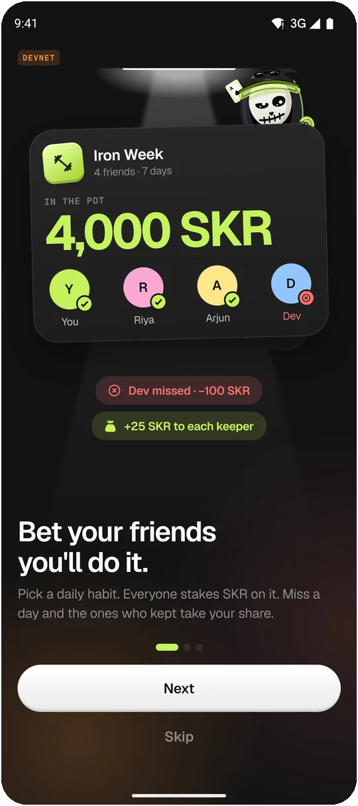<br><sub><b>Bet your friends</b></sub></td>
    <td align="center">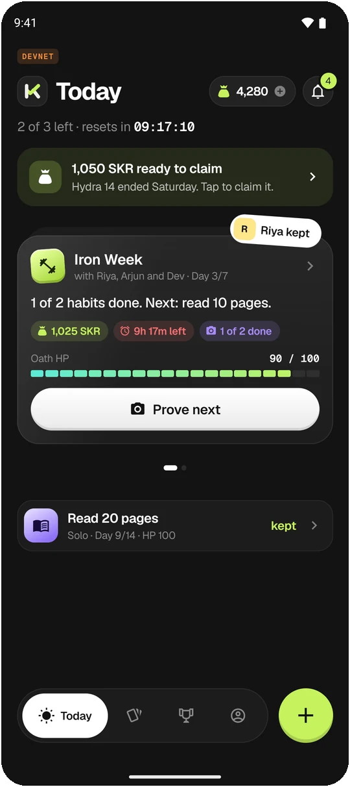<br><sub><b>Today</b>: what's due, what's won</sub></td>
    <td align="center">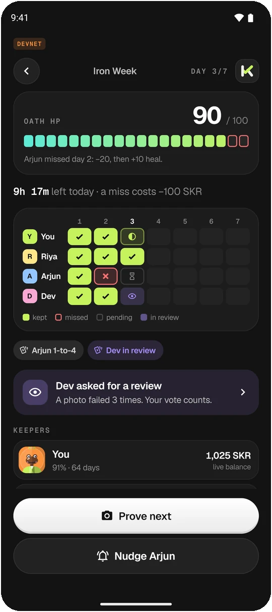<br><sub><b>Oath HP</b> and the day grid</sub></td>
    <td align="center">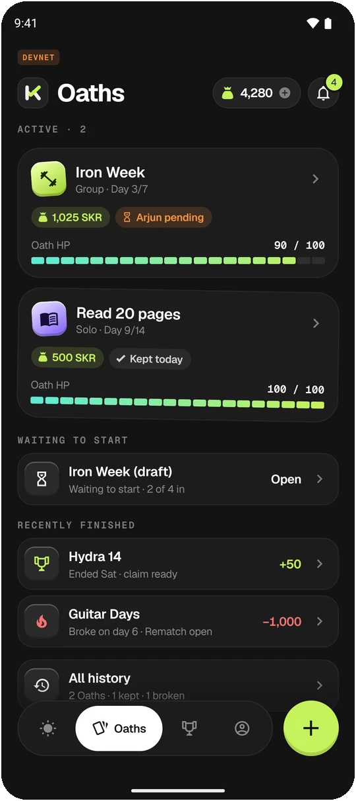<br><sub><b>Oaths</b>: active, waiting, finished</sub></td>
  </tr>
  <tr>
    <td align="center">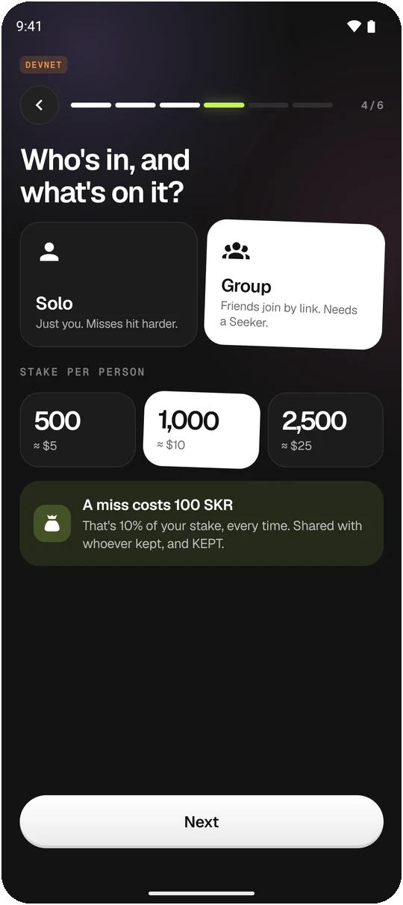<br><sub><b>Who's in</b> and what's on it</sub></td>
    <td align="center">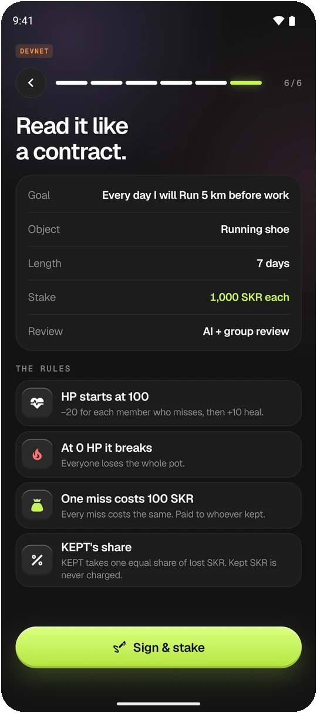<br><sub><b>Read it like a contract</b></sub></td>
    <td align="center">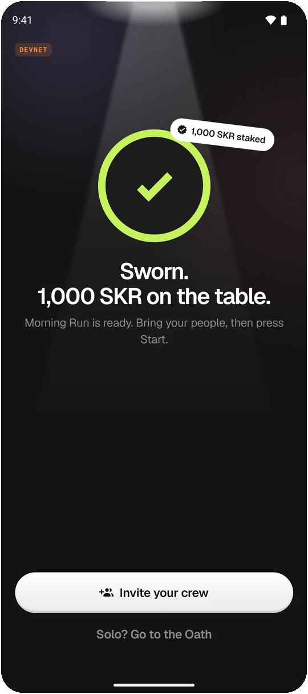<br><sub><b>Sworn</b>: stake signed on chain</sub></td>
    <td align="center">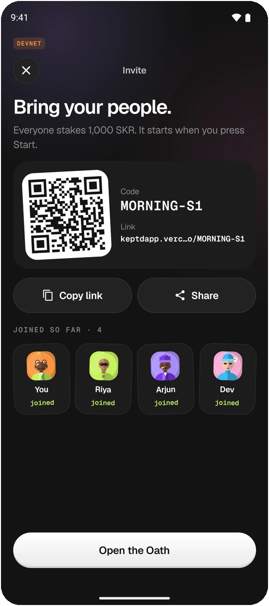<br><sub><b>Invite</b> by QR or link</sub></td>
  </tr>
  <tr>
    <td align="center">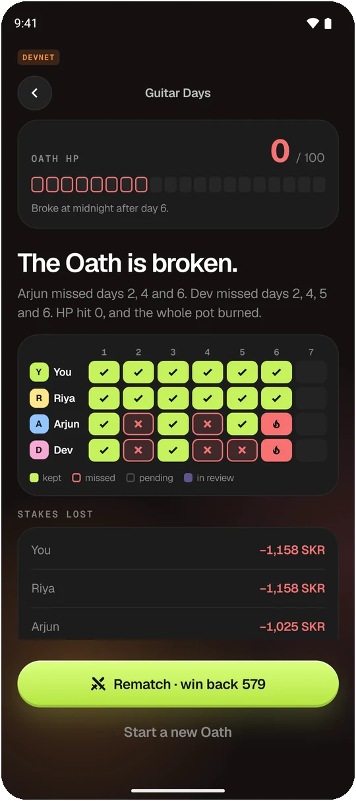<br><sub><b>Broken</b> at 0 HP</sub></td>
    <td align="center">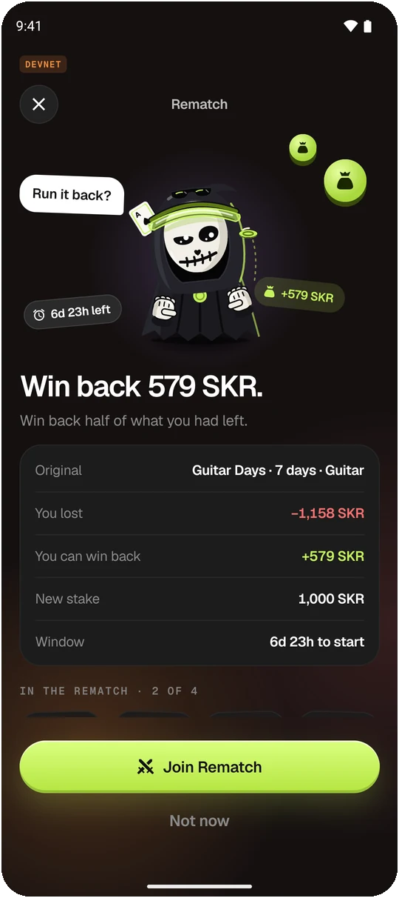<br><sub><b>Rematch</b>: win back half</sub></td>
    <td align="center">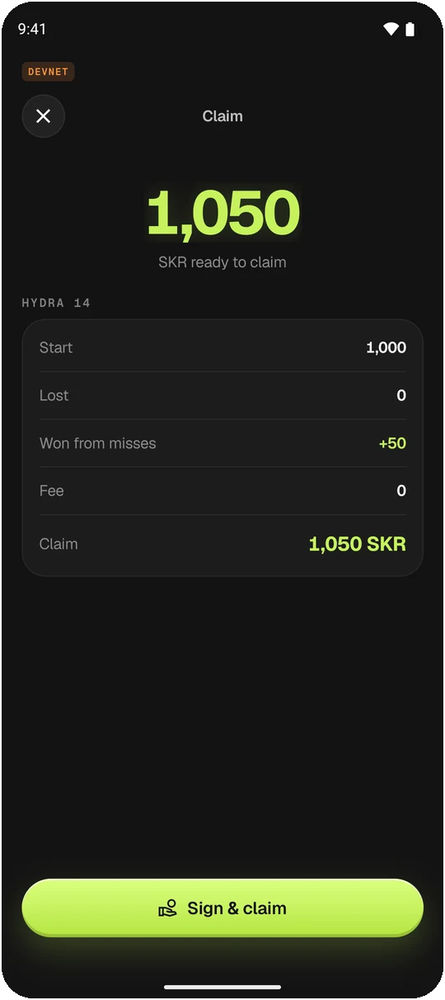<br><sub><b>Claim</b> your payout</sub></td>
    <td align="center">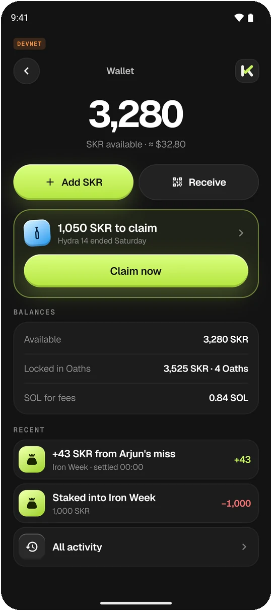<br><sub><b>Wallet</b>: SKR, SOL, claims</sub></td>
  </tr>
  <tr>
    <td align="center">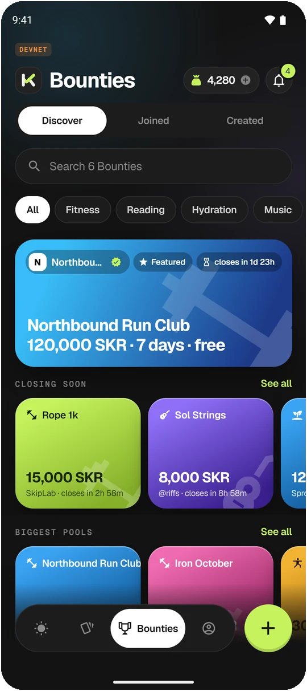<br><sub><b>Bounties</b>: free public challenges</sub></td>
    <td align="center">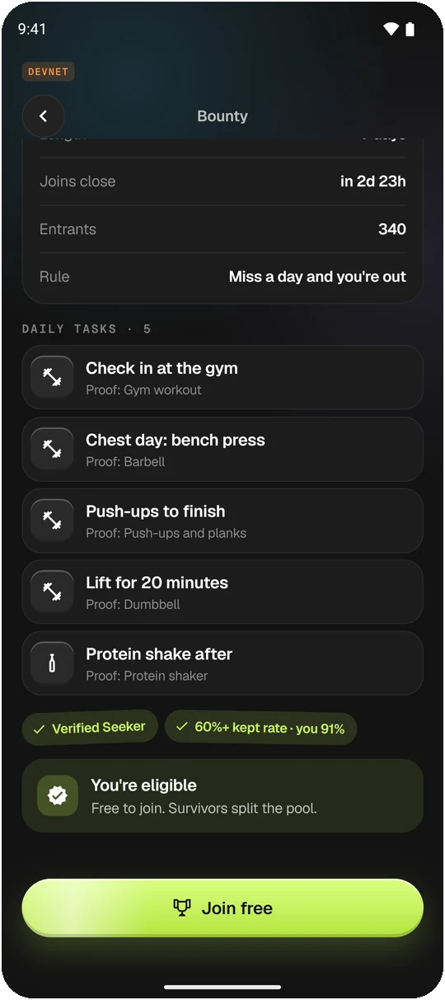<br><sub><b>Bounty</b>: a sponsor's daily tasks</sub></td>
    <td align="center">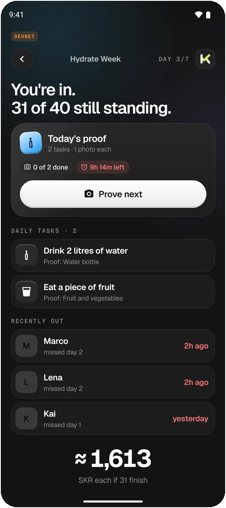<br><sub><b>Prove every task</b>, one photo each</sub></td>
    <td align="center">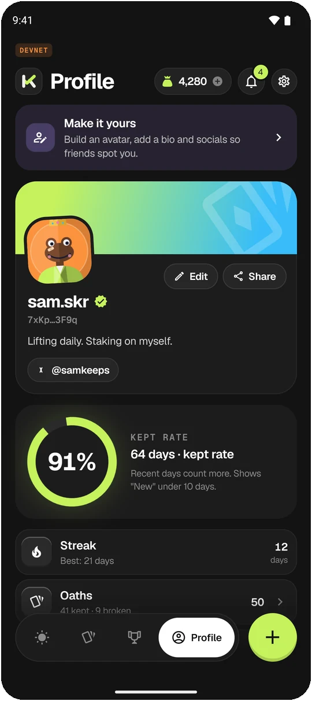<br><sub><b>Profile</b> and kept rate</sub></td>
  </tr>
</table>

<sub>Captured from the release APK in Demo mode.</sub>

## 📲 Download and try it

<a href="https://github.com/priyambuilds/Kept/releases/latest/download/KEPT.apk"><b>⬇️ Download the latest KEPT.apk</b></a> (Android 7.0+, arm64: the Solana Seeker and any modern Android phone). Every version is on the [Releases](https://github.com/priyambuilds/Kept/releases) page.

1. Open the link on your phone, or copy the APK over USB (`adb install -r KEPT.apk`).
2. Tap the file and allow **Install unknown apps** when Android asks.
3. Open **KEPT** → **Get started** → pick a mode.

| | 🎮 **Try the demo** (recommended) | 🔗 **Use my wallet** (Live) |
|---|---|---|
| What it is | A sample account on a simulated backend, wallet and program | The real app on Solana **Devnet** |
| Needs | Nothing. No wallet, no SKR, no network (works in airplane mode) | Any Mobile Wallet Adapter wallet (Seeker Wallet, Phantom, Solflare), devnet SOL |
| Signing | Simulated: signing screens say *"Demo: the approval is simulated."* | Real transactions in your wallet |
| Reset | Profile › Settings › **Restart demo** / **Exit demo** | Sign out returns to the start |

**Two-minute tour:** [`docs/DEMO_SCRIPT.md`](docs/DEMO_SCRIPT.md) walks through the core loop, including **Skip to tomorrow** (Profile › Settings), which settles a day so you can watch a miss cost HP and stake.

<details>
<summary><b>What is real in Live (Devnet)</b></summary>

<br>

| Real on Devnet | How |
|---|---|
| Sign-in | Sign-In With Solana message signed in your wallet, checked by the backend; Seeker Genesis Token check |
| Create, join, start, cancel, settle, claim an Oath | Transactions to the Anchor program `kept_test` ([`6iXXBqsdiCnUTSVf8CW3Uuw8c7iYvZSj5haz64QMuMUh`](https://explorer.solana.com/address/6iXXBqsdiCnUTSVf8CW3Uuw8c7iYvZSj5haz64QMuMUh?cluster=devnet)); stakes are escrowed on chain |
| Daily proof | On-device check (MediaPipe gesture model + Gemma, downloaded on first use, about 2.6 GB, on a physical 64-bit phone). The photo stays on the phone; the verdict and photo hash go to the backend |
| Balances, test SKR | Read from RPC; the faucet sends test SKR once per wallet |
| Invites, nudges, inbox, kept rate | The backend (kept rate is the backend's plain kept / (kept + missed), "New" under 10 days) |
| Bounties | The backend's current Bounty: list, detail and join |

**Not in Live yet** (hidden or shown as unavailable, never faked): Rematch, creating a Bounty, Bounties with several tasks (Live's Bounty has one), swap, creator pages and group review of habit photos. HP and cost-per-miss on Oath screens are computed in the app by [`packages/engine`](packages/engine); what the program pays follows its own rules on Devnet. Details: [`docs/BACKEND_GAPS.md`](docs/BACKEND_GAPS.md).

</details>

## 🎯 How it works

| | Rule |
|---|---|
| **Swear** | Name the Oath, add habits (each with its own proof object), pick 3, 7 or 14 days, solo or group, and a stake per person. Sign once; the stake goes into escrow. |
| **Prove** | Each habit, each day: one live photo of the object plus the hand gesture KEPT asks for. Camera only, no gallery. Checked on the phone. |
| **HP** | Every Oath starts at 100 HP. At the end of each day: −20 per member who missed (−35 solo), then +10 heal, capped at 100. At 0 the Oath breaks. |
| **Miss** | A miss costs 10% of your stake, shared between that day's keepers and KEPT. |
| **Review** | Choose *AI only* or *AI + group review*: after 3 failed checks of a photo, the group votes. |
| **Get paid** | When the Oath ends, claim what you kept plus what you won from others' misses. |
| **Rematch** | A broken Oath can be run back: keep every day of the Rematch and win back half of what you lost. |
| **Bounties** | A sponsor funds the pool and sets the daily tasks (say: check in at the gym, bench press, push-ups, a protein shake), each with its own proof object. Joining is free; prove every task every day to stay in, and survivors split the pool. |

Product rules in full: [`design/rules.md`](design/rules.md), with amendments in [`docs/DECISIONS.md`](docs/DECISIONS.md).

## 🧱 Architecture

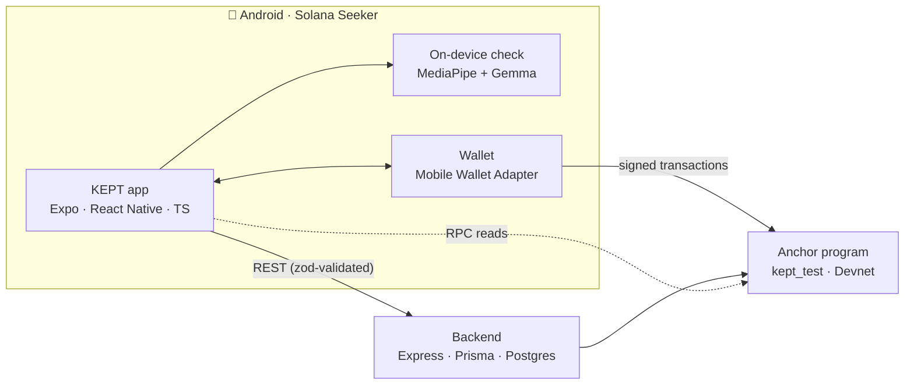

| Layer | Stack |
|---|---|
| **App** | Expo SDK 57 (development build), React Native 0.86 (New Architecture, Hermes), TypeScript strict, React Navigation, TanStack Query, Zustand, Zod, Reanimated 4, Skia, react-native-svg, expo-camera |
| **Wallet and chain** | Solana Mobile Wallet Adapter, `@solana/web3.js`, Anchor IDL client in [`packages/chain`](packages/chain) |
| **Rules engine** | Pure TypeScript in [`packages/engine`](packages/engine): HP, cost per miss, daily distribution, Rematch recovery, kept rate, odds, with JSON test vectors shared with the Rust tests |
| **On-device AI** | A local Expo module ([`frontend/modules/kept-gesture`](frontend/modules/kept-gesture)) running MediaPipe gesture recognition and Gemma (LiteRT-LM) |
| **Backend** | Express + Prisma + Postgres ([`backend/`](backend)) |
| **Program** | Anchor (Rust), [`onchain/programs/kept_test`](onchain) |
| **Design** | 116 screens, tokens, copy and motion from the design handoff in [`design/`](design); theme and strings are generated from it, never hardcoded |

### Repository layout

| Path | Layer | What |
|---|---|---|
| [`frontend/`](frontend) | UI | The Expo app (Android, Solana Seeker) |
| [`backend/`](backend) | Node backend | Express + Prisma backend (V4 Devnet prototype) |
| [`onchain/`](onchain) | On-chain (Rust) | Anchor program `kept_test` |
| [`packages/*`](packages) | Shared TS | config, engine, schemas, chain client |
| [`infra/`](infra) | Infra | `docker-compose.yml` (local Postgres) |
| [`design/`](design) | Design | The design handoff (read-only source of truth) |
| [`docs/`](docs) | Docs | Architecture, backend gaps, decisions, build plan, API; `docs/notes/` for session reports |
| [`legacy/`](legacy) | Reference | V3 Aura backend code, program tests and docs (not built) |
| [`patches/`](patches) | Tooling | pnpm dependency patches |

Each top-level folder has a `README.md` describing its contents.

## 🛠 Development

**Requirements:** Node ≥ 20, pnpm, Docker (local Postgres). For the app: Android Studio (SDK + platform tools, `ANDROID_HOME` set) and JDK 17. For the program: Rust, Solana CLI (Agave), Anchor 1.2.0.

### Backend

```bash
pnpm install
pnpm db:up                             # Postgres 16 on localhost:5432 (user/pass/db: kept)
cp backend/.env.example backend/.env   # then fill it in (see backend/.env.example)
pnpm --filter kept-backend exec prisma migrate deploy
pnpm api:dev                           # http://localhost:3000
```

### App on an Android phone

The app is a **development build** (Expo Go can't run the wallet adapter or the camera). On the phone, turn on **Developer options → USB debugging**.

```bash
pnpm install
adb devices                      # the phone must be listed as "device"
pnpm mobile:android              # prebuilds android/, builds and installs app.kept.mobile, starts Metro on 8082
```

After the first install you only need Metro: `pnpm mobile:start`, then open **KEPT** on the phone (same Wi-Fi, or `adb reverse tcp:8082 tcp:8082` over USB). Shake the phone (or `adb shell input keyevent 82`) for the dev menu.

**Demo and Live (D-80).** On first launch, **Get started** asks how to start:
- **Try the demo:** a sample account on the built-in mock. No wallet, no network, works in airplane mode. There is no DEMO badge on screen (owner, 2026-10-12); signing screens say the approval is simulated. Profile → Settings → **Restart demo** puts the account back the way it began; **Exit demo** wipes it and goes back to the start.
- **Use my wallet:** Live. Real wallet (MWA), real backend, real program, no mock data. Features the backend doesn't have yet are hidden; see [`docs/BACKEND_GAPS.md`](docs/BACKEND_GAPS.md). Signing out returns to the start, where the mode can be picked again.

"I have an invite" and `kept://join/<code>` links always use Live.

### Checks

```bash
pnpm typecheck
pnpm lint
pnpm test
pnpm program:build && pnpm program:test   # build the program first; its tests load target/idl
```

CI ([`.github/workflows/ci.yml`](.github/workflows/ci.yml)) runs typecheck, lint and tests for the app and packages on every push and pull request.

<details>
<summary><b>Live against your local API</b></summary>

<br>

1. Start the backend (above). In `backend/.env` put your phone wallet's address in `SGT_MOCK_ALLOWLIST` to get **A3 Seeker verified**; leave it out to see **A3·no**.
2. `cp frontend/.env.example frontend/.env` and set `EXPO_PUBLIC_STAKE_MINT` (the `STAKE_MINT` printed by the API's `v4-setup` script) so the balance chip shows SKR. The example points to the hosted Devnet API; to use the local API, set `EXPO_PUBLIC_API_URL=http://localhost:3000`.
3. `adb reverse tcp:8082 tcp:8082` for Metro, and `adb reverse tcp:3000 tcp:3000` for the local API.
4. Open KEPT → **Get started** → **Use my wallet** → pick a wallet row → approve the connect, then the sign-in message in your wallet.

</details>

<details>
<summary><b>Dev menu and deep links</b></summary>

<br>

In development builds, long-press the orange **DEVNET** badge. Override any slice to `http` or `mock`, pick a mock scenario (`judges`, `notEligible`, `walletRejected`, `offline`, `noSkr`, …), use the mock wallet in Live, move the virtual clock, jump to any of the 116 screens, open the component **Gallery**, or sign out.

Deep link test: `adb shell am start -a android.intent.action.VIEW -d "kept://join/IRON-7K2Q"`.

</details>

<details>
<summary><b>Testing the core loop</b></summary>

<br>

- **In Demo (fastest):** Today has Iron Week with a habit still to prove, Hydra 14 to claim, and a joined Bounty; Oaths → Guitar Days is broken with a Rematch offer. In a development build, Dev menu → **End day** / **To deadline** moves time: other members prove on their own and Oaths settle after their last day.
- **On Devnet (Live, two phones or two wallets):** both wallets need devnet SOL and SKR (`POST /api/faucet` gives 5,000 SKR once). Phone 1: + → Start an Oath → Group → Sign & stake → Invite (QR). Phone 2: + → Join with code → scan → Join & stake. Phone 1: Start. On chain a solo Oath has no stake (D-30).

</details>

<details>
<summary><b>Testing Rematch, review, Bounties, profiles, inbox and wallet</b></summary>

<br>

In Demo (or a development build with the mock scenario of your choice):
- **Rematch:** Oaths → Guitar Days → **Rematch · win back …** (R1) → Join → R3 lobby. Scenario `rematchActive` shows R·act; **End day** through its last day for R4 / L6.
- **Group review:** bell → **Review photo** (G1) → Approve or Reject. To ask for one: an "AI + group review" Oath → prove a habit → scenario `proofFail` three times → **Ask your group to review** (G2).
- **Bounties:** Bounties tab → any Bounty → **Join free** → H3; `bountyOut` → H4, `bountyJoined` → H5. **Created** → **Create a Bounty** (K1–K5).
- **Profiles, inbox, wallet:** Profile tab (I1, I4, I5, I7, I8, I9), the bell (N1), the balance chip (W1 → W2 → W3 swap / faucet, W4 receive).

</details>

## 🚀 Releases

Release APKs are built by GitHub Actions ([`.github/workflows/release.yml`](.github/workflows/release.yml)) and attached to a [GitHub Release](https://github.com/priyambuilds/Kept/releases) with screenshots, install steps and a SHA-256 checksum.

```bash
git tag v0.2.0
git push origin v0.2.0           # builds the APK and publishes the release "KEPT v0.2.0"
```

You can also run it by hand: **Actions › Release APK › Run workflow**, enter a tag. The asset is always named `KEPT.apk`, so [`releases/latest/download/KEPT.apk`](https://github.com/priyambuilds/Kept/releases/latest/download/KEPT.apk) serves the newest build. The version name comes from the tag; the version code goes up with every run, so each release installs over the last.

<details>
<summary><b>Signing and build settings</b></summary>

<br>

- **Signing.** Set the repository secrets `ANDROID_KEYSTORE_BASE64`, `ANDROID_KEYSTORE_PASSWORD`, `ANDROID_KEY_ALIAS` and `ANDROID_KEY_PASSWORD` to sign with your own key ([`frontend/plugins/withReleaseSigning.js`](frontend/plugins/withReleaseSigning.js)). Without them the APK is signed with the standard debug key, like a local build. Pick one and keep it: Android won't update an app signed with a different key.
- **Build settings.** Repository variables `EXPO_PUBLIC_API_URL`, `EXPO_PUBLIC_STAKE_MINT`, `EXPO_PUBLIC_RPC_URL` and `EXPO_PUBLIC_PROGRAM_ID` override the defaults in [`frontend/src/config/env.ts`](frontend/src/config/env.ts). By default Live uses the hosted Devnet API at `https://kepttestapp.onrender.com`; a release build pointing at `localhost` refuses Live with a message.
- **Local release build.**
  ```bash
  cd frontend/android && ./gradlew assembleRelease     # → app/build/outputs/apk/release/app-release.apk
  ```

</details>

## 📚 Docs

| Doc | What |
|---|---|
| [`docs/ARCHITECTURE.md`](docs/ARCHITECTURE.md) | How the app, packages, backend and program fit together |
| [`docs/DEMO_SCRIPT.md`](docs/DEMO_SCRIPT.md) | A two-minute walkthrough of the core loop |
| [`docs/DECISIONS.md`](docs/DECISIONS.md) | Product and engineering decisions, rule amendments |
| [`docs/BACKEND_GAPS.md`](docs/BACKEND_GAPS.md) | What the backend and program still need to match the design |
| [`docs/API.md`](docs/API.md) | The backend API as it exists today, plus proposed routes |
| [`docs/BUILD_PLAN.md`](docs/BUILD_PLAN.md) | How the app was built, phase by phase |
| [`design/`](design) | The design handoff: screens, components, tokens, copy, motion, rules |

<p align="center">
  <br>
  <br>
  <sub><b>KEPT</b> · keep your word · built for the Solana Seeker</sub>
</p>
