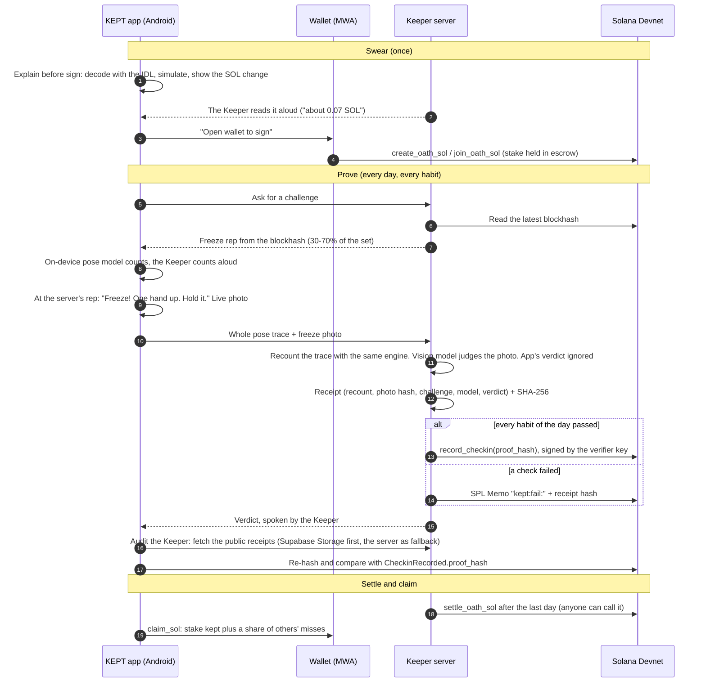

# KEPT pitch

**KEPT: Oaths you can't fake.** Friends stake SOL on a daily habit and share one HP bar. For a workout, the phone counts your reps live, the server counts them again from the same pose trace, and a "Freeze!" photo at a rep picked by the Solana blockhash ties the set to a real person. The Keeper, an AI judge with a voice, writes a receipt for every verdict. The receipt's hash goes on Solana, so anyone can check it. Native Android, Solana Devnet, test SOL.

> Habit apps trust your word. Crypto habit apps trust your phone. KEPT trusts neither.

This document is for judges. Each `## Slide` section is one slide of a 10-slide deck: the bullets go on the slide, and the speaker notes are what we say over it. Status as of 2026-11-27: [v1.4.2](https://github.com/ekanshvcpkg/KEPT-DAPP/releases/tag/v1.4.2) is published with a signed APK, and KEPT runs on our own program deployment and our own hosted API on Devnet. If something is not proven, this document says so.

---

## Slide 1: The problem

- **Habit apps trust your word.** A streak is a checkbox. Tapping "done" costs nothing, so the streak means nothing.
- **Crypto habit apps trust your phone.** Steps come from a fitness app on the device, or the app decides pass or fail itself. A modified client or a borrowed phone wins.
- **Group stake apps make your friends profit from your failure.** Losers' stakes go to winners. That is a bet against your friends, not support for them.
- Money at stake works (stickK, Beeminder and Forfeit have shown it for years), but only if the proof is honest and the group is on the same side.

**Speaker notes.** Everyone in this room has broken a resolution. Putting money on it helps: commitment contracts are a proven idea, and stickK has run them since 2008. The problem is the judge. Either you grade yourself, a friend grades you and usually takes your word, or the app trusts whatever the phone reports. When the money is real and the judge is weak, faking a day is the rational move. In a group, faking a day takes money from friends who were honest. And in most group stake apps, your friends win money when you fail, so nobody has a reason to help you show up.

---

## Slide 2: The solution: proof you can't fake

1. **The phone counts.** Nine live activities: push-ups, squats, jumping jacks, lunges, sit-ups, high knees, burpees, overhead presses (reps) and a plank (seconds). An on-device pose model (MediaPipe) counts from any horizontal angle while the Keeper counts aloud.
2. **The server counts again.** The phone uploads the whole pose trace. The server recounts it with the same deterministic engine before anything goes on chain. Half reps, knee push-ups, piked hips, waist-bend squats, one-arm jumping jacks, frozen poses and replayed sets are refused.
3. **The blockhash picks the freeze.** At a rep the server picks from the Solana blockhash, the Keeper says **"Freeze! One hand up. Hold it."** The phone takes a live photo, and a vision model on the server checks it for a real person mid-activity with one hand raised.
4. **The receipt goes on chain.** Every verdict is a public receipt. A kept day puts the receipts' hash on chain with `record_checkin`; a failed check is published in an SPL Memo. **Audit the Keeper** re-hashes the receipts on your phone and compares them with Solana.

Around the proof:

- **One HP bar for the group.** 2 to 4 members (or solo), one Oath, one health bar. A miss costs −20 HP (−35 solo), every day heals +10, and at 0 HP the Oath breaks for everyone. You want your friends to show up.
- **A Keeper with a voice.** In its own ElevenLabs voice, the Keeper counts reps, adds hype lines between them, speaks every verdict, and reads each transaction aloud before your wallet opens ("about 0.07 SOL"). **Ask the Keeper** answers questions about your Oaths. **Stop the Keeper** silences it with one tap.
- **Photo habits** (a book, a water bottle) use one live photo of the object plus a hand gesture picked from the blockhash.

**Speaker notes.** Here is what "can't fake" means, exactly. Tapping "done" does nothing. A verdict sent by the app is ignored. A set or photo that already passed can't pass again. Half reps and knee push-ups fail the server's recount. The freeze photo has to be live, taken at the server's rep, with a hand up. Real line from the owner's phone test of the release build, after 10 push-ups: "Kept. The photo shows a live scene of a person doing a push-up with one hand raised." Now what it doesn't mean. The pose trace comes from the phone, so a modified app could make up a moving trace. The freeze photo is what ties the set to a real person. Freeze photos are deduplicated by exact bytes only. And the model can be wrong: it once failed a real squat set because it said the person was standing, and that receipt is on chain. We fixed the cause. Every verdict leaves a receipt, so a wrong one is visible, not hidden.

---

## Slide 3: How the proof works

A photo habit follows the same path, with a hand gesture from the blockhash instead of a freeze rep, and no recount.

**Speaker notes.** Walk the diagram top to bottom. The challenge comes from a recent blockhash, so nobody can know the freeze rep before the challenge is issued, and a recorded set won't freeze at the right rep for a new challenge. The phone and the server run the same rep engine: [`packages/engine/src/reps.ts`](../packages/engine/src/reps.ts) and a byte-identical copy in `backend/src/shared/reps.ts`, pinned by golden test vectors. The receipt is canonical JSON. Its SHA-256 is public, and `proof_hash` on chain is the SHA-256 of the day's receipt hashes in habit order. The Keeper's key is the only key our program accepts for check-ins. It cannot upgrade the program or move stakes. Payouts are computed on chain by the same rules the app shows, tested against the same vectors. The server settles each Oath after its last day, but anyone can call settle.

---

## Slide 4: Why Solana, why now

**Why Solana**

- **A check-in every day per person is cheap.** A 4-person, 14-day Oath has 56 check-ins. At the base fee of 5,000 lamports per signature, that is about 0.00028 SOL in fees for the whole Oath (before any priority fee).
- **Fast enough for a daily ritual.** In the Devnet workflow runs, the recount, the verdict and the on-chain check-in fit inside 2-minute test days.
- **A public, permanent place for the judge's work.** Receipt hashes and fail memos sit where nobody, including us, can quietly edit them.
- **Mobile Wallet Adapter.** A native Android app signs with any Mobile Wallet Adapter wallet (we have tested Phantom). No browser wallet, no PWA wrapper.
- **Seeker.** Built for the Solana Seeker (camera-first, MWA). The Seeker Genesis Token check is mocked with an allowlist on Devnet, because Genesis Tokens live on mainnet.

**Why now**

- **Pose models run on the phone.** MediaPipe counts reps live on an ordinary Android phone. The phone uploads the pose trace, the freeze photo and one final frame (no video), and the server can recount the trace in plain code.
- **Vision models can judge one live photo.** The Keeper asks a hosted vision model (`google/gemma-3-27b-it` by default) whether the freeze photo shows a real person mid-activity with one hand up, and whether it is a photo of a screen or a printout.
- **Solana Mobile has a phone, a wallet standard and a store.** Seeker, MWA and the dApp Store make a native crypto app normal. Moonwalk ran a Seeker campaign [3].
- **Voice makes the judge a character.** ElevenLabs Voice Design, text-to-speech and speech-to-text give the Keeper a voice people remember.
- **"Stake on habits" is getting crowded, and the judge is still weak.** Lock-In [1], Moonwalk [2] and Stakehold [4] already let people stake on habits. They judge with step data from the phone or a fitness app, or an AI check of a photo. None of them counts the workout itself.

**Speaker notes.** On a chain with high fees, a check-in per person per day could cost more than a small stake. On Solana, all 56 check-ins of that 14-day, 4-person Oath cost about 0.00028 SOL in base fees. The "why now" is that every piece of honest proof just became cheap enough for a phone: pose tracking on the device, a vision model on the server, and a chain that can hold a hash for every day.

---

## Slide 5: Demo moments

What we show, in order. Every take says on screen that it runs on Solana Devnet with test SOL.

| # | Moment | What the audience sees | Evidence |
|---|---|---|---|
| 1 | **"About 0.07 SOL"** | Swear an Oath. The Keeper reads the transaction aloud before the wallet opens. The wallet opens only on "Open wallet to sign". | In v1.4.2 ([release notes](releases/v1.4.2.md)) |
| 2 | **The Keeper counts** | 10 push-ups facing the phone. The Keeper counts aloud and throws in hype lines. "Stop the Keeper" shows while it talks. | Release build on a real phone: 10 of 10 counted |
| 3 | **"Freeze! One hand up. Hold it."** | At the server's rep, the photo, then the spoken verdict: "Kept. The photo shows a live scene of a person doing a push-up with one hand raised." | Same phone test: recounted by the server, freeze photo passed, day kept |
| 4 | **A cheat refused** | Half reps or knee push-ups. The app says which part failed (the raised hand, the pose or the recount) and gives the Keeper's reason. | The server's recount refused every cheat set in the Devnet workflow run (synthetic traces). TODO (owner): film a real cheat attempt on the phone. |
| 5 | **Audit the Keeper** | The day-kept screen: the app re-hashes the receipts and matches the chain. Cut to Explorer: `record_checkin` signed by the verifier `6tcC…`. | Workflow run 2: every receipt re-hashes, and the combined hash equals the on-chain `proof_hash`. Phone audit matched on 2026-11-26 (debug build). |
| 6 | **Ask the Keeper** | Hold and ask "what do I still have to do today?". The Keeper answers in one or two short sentences. | In v1.4.2 ([`ask.ts`](../backend/src/v4/ask.ts), [`keeperAgent.ts`](../backend/src/v4/keeperAgent.ts)) |
| 7 | **Friends, settle, claim** | A friend's proof appears on every phone (Supabase Realtime). After the last day the server settles on its own and each member claims. | Workflow run 1: group lifecycle, payouts equal to the rules engine to the lamport. Realtime is in v1.4.2 but not yet filmed on two phones. TODO (owner): film it. |

TODO (owner): add the demo video link and the check-in signatures from the recording.

**Speaker notes.** Moments 2 and 3 are the heart of the pitch: the count, the freeze and the verdict happen live, in one take. A release-build day is 24 hours, so moment 7 comes from the Devnet workflow run, where days are 2 minutes. We say that on screen. The full shot plan is in [`DEMO_VIDEO.md`](DEMO_VIDEO.md).

---

## Slide 6: What is real today

Our program [`7VpBDwXiDvvaG29VBFUPankoSWFVanyD9KcT7wbmLVzj`](https://explorer.solana.com/address/7VpBDwXiDvvaG29VBFUPankoSWFVanyD9KcT7wbmLVzj?cluster=devnet) on Devnet, our API at [`kept-api-vxk8.onrender.com`](https://kept-api-vxk8.onrender.com/health) (its `/health` reports the build commit), and the v1.4.2 release APK.

| What | Evidence |
|---|---|
| Signed release APK v1.4.2 (Android 7.0+, arm64), SHA-256 `7c30ee6c72f0b9d17b971fa9d65d705d6b43937bafbd75a8b7966e0623b55e71` | [Release page](https://github.com/ekanshvcpkg/KEPT-DAPP/releases/tag/v1.4.2), [release notes](releases/v1.4.2.md) |
| Release build on a real phone (Samsung): front-view push-ups counted 10 of 10 by the phone and by the server, freeze photo passed the AI judge, day kept | Owner's test of v1.4.2. TODO (owner): add the check-in signature from this run. If it is Oath A in [`SUBMISSION_EVIDENCE.md`](SUBMISSION_EVIDENCE.md) §5 (push-ups, same verdict text), say so there. |
| Whole workflow on the real Devnet program, all 9 activities and 2 photo habits: 73 of 73 checks passed. Cheat sets refused by the recount, honest sets recounted and judged, days recorded on chain, every public receipt re-hashes, on-chain `proof_hash` equals the combined receipt hashes | [`e2e_all_habits.ts`](../backend/scripts/e2e_all_habits.ts) run 2 (2026-11-27, local backend, stand-in vision judge, synthetic rep sets). Oaths [`CvqjVtHy…`](https://explorer.solana.com/address/CvqjVtHyWKsMmPGEKzNMEZWaCe2qcUxM5qyEsaeFkG4p?cluster=devnet), [`qcG5zEgh…`](https://explorer.solana.com/address/qcG5zEghFLRPt5hcm2mTXrsXA55XsSjxyJZPLSqvKEF?cluster=devnet). Check-ins [tx 1](https://explorer.solana.com/tx/3pZBWaMsfSRWKXVrTxsVWYdfuUN4LsKmfXm8pNg1ayKSqXknGk8oN1zNcsd3a7huAXi9hxfwnictJouKmD7fxuqS?cluster=devnet), [tx 2](https://explorer.solana.com/tx/RbsHUdPWyFipKjE9nPm9ViM4LLxZ8FfZJTTB4yyCj72hJL6EYQnzKd52hGvtTxKnNQjEcU4CHFAb3o1Dxu9VF9b?cluster=devnet) |
| Group lifecycle: 3 of 4 seats, started with 3, a 4th wallet refused after the start, member C missed day 2, the server settled on its own within 45 s of the end, payouts equal to the rules engine to the lamport (A 5,166,666, B 5,166,666, C 4,500,000 lamports), all 3 claimed | Run 1 (2026-11-27). Group Oath [`AdZwZ2fN…`](https://explorer.solana.com/address/AdZwZ2fNF16GXaiY7ck4rzQogKMyM5KfvYPuKjih74H6?cluster=devnet) |
| A real failed verdict on chain (a squat set the AI said was standing; since fixed) | Receipt `05de54fe64e27cdc7a5ad58d5722dab53cc05459391f5ad1035445145fc7e46c`, [fail memo](https://explorer.solana.com/tx/REnzza4qF9tX3aAoYjNUjUinPmmZ2sCASCaTXqimwN7bLvUnL9DRQw2EUZakFq4VFxQn6dhVUDVoQD8hY8ts8JL?cluster=devnet) |
| Earlier phone run, photo habit (2026-11-26, debug build, local backend, Phantom): create and stake, check-ins with the receipt hash, audit matched, settle and claim with the exact payout (stake minus one 10% miss: 0.063259999 SOL) | [App run notes](notes/app-devnet-run-2026-11-26.md): [create](https://explorer.solana.com/tx/3KVr6xkP7Ax4qJLS3fLmSfCXiioLiHpjqzTuK5zsZSzXNHx8aFW3b67swExGc5q59qWBQuJ9edm4LEgi1oSA1qet?cluster=devnet), [day 2](https://explorer.solana.com/tx/56FCHqE8Pgu52QVFsikdPrYKGxmbKuyHDSsTDgaXKpvJorG5EMdQAEpPv1qpMDKfPXpPGerGufXEbxS73G4LedQe?cluster=devnet), [day 3](https://explorer.solana.com/tx/5Hqv8Pf8FNAADa53RA88MNRXr5CwmreQkMPtVPL3JTyXwa7sd4Q9zyYdhyv5cpqHEXpkJALbqPtTxGYwzAQiqprc?cluster=devnet), [settle](https://explorer.solana.com/tx/32fta5f583QKW6LZEPueMcQbuMkARui82qRy79EcXmi9JVTi3rWphzBGwxTZ7CnRi6BWcct5pau1DN1Emr1GWthN?cluster=devnet), [claim](https://explorer.solana.com/tx/4qbaLisirNMvTjhMEJm9nKmdNuKDwgDH8TzRC1UkvEbSMjzyfsRv7RCbzszKGj38quU9xejJe5RCkQKLscxntu8v?cluster=devnet) |
| Explain before sign (IDL-decoded transaction, simulated SOL change, wallet opens only on tap) | [`explain.ts`](../packages/chain/src/explain.ts) (decoding), [`mwa.ts`](../frontend/src/chain/mwa.ts) (simulation) |
| Tests at the release | Engine 111, backend 141, app 552 (Jest). All pass. |

**Not done yet:** the Solana dApp Store listing, the demo video, and check-in signatures from the release app with a real wallet (see the TODOs above). Rematch recovery and Sponsor Bounties are not on chain.

**Speaker notes.** Everything on this slide has a link. Click any check-in and you will see the `proof_hash`. For the real phone days in [`SUBMISSION_EVIDENCE.md`](SUBMISSION_EVIDENCE.md) §5, fetch the receipts from `https://kept-api-vxk8.onrender.com/keeper/receipts/<hash>` and re-hash them yourself. The workflow runs kept their receipts in a local database, so for those you can check the on-chain side only. The workflow run uses a stand-in vision judge and synthetic rep sets so it can run unattended, but the program and the transactions are real. The group run shows every lamport accounted for: payouts, treasury and held funds add up to all the stakes. Be clear about what was inherited: the app, its screens, the rules engine, the Anchor program source and the Express backend existed before the hackathon. In that version, Live proofs trusted the phone's verdict. During the hackathon our team built the Keeper, receipts, the audit, explain-before-sign, the voice, the live rep counter, Ask the Keeper, the hosted stack, our own program deployment and the signed release (README, "Hackathon: what existed before, what we built during"). Every address and signature: [`SUBMISSION_EVIDENCE.md`](SUBMISSION_EVIDENCE.md).

---

## Slide 7: Business model

- **Protocol fee on misses.** A miss forfeits 10% of that member's stake. It is split into equal shares: one for each friend who kept the day, one for KEPT. In a solo Oath, or a day where everyone missed, the miss goes to KEPT. If everyone keeps every day, nobody pays anything.
- **Sponsor Bounties: pay only for verified outcomes.** A brand or gym funds a pool and sets daily tasks; joining is free; survivors who prove every task split the pool. If nobody survives, the pool goes back to the sponsor. KEPT takes 10% when the pool is funded. *Built in Demo mode; joining is hidden in Live; not on chain yet.*
- **Roadmap: HP-priced pledges ("back, don't bet").** Family, an employer or a coach pledges toward someone's Oath. The payout is `pledge × final HP / 100`, with a full refund at 0 HP. Backers pay only for what was verified and can never profit from a failure.
- **Low running cost per user:** one vision call per proof (plus a recount in plain code for a rep set), one check-in transaction per member per day. Rep counts, "Freeze!" and hype lines are voice clips generated once and bundled in the app; other voice lines are cached.

**Speaker notes.** We earn when people break their word, but much less than a solo-penalty app does: in a group, KEPT gets one share of a miss and the friends who showed up get the rest. A broken Oath (0 HP) is the expensive case: half of what is left goes to KEPT and half is held for a Rematch. Rematch recovery is not on chain yet, so today that held half also ends with KEPT after 7 days; we say so in the README. A live workout proof is a strong fit for Bounties: a sponsor pays for people who actually did 20 push-ups a day for 14 days, counted twice and checked by the Keeper. Pledges are the long-term idea: money that rewards progress, priced by the HP bar.

---

## Slide 8: Competition, and why we're different

| | Stake | Proof | Who judges | Can you check the verdict? | Where a miss goes |
|---|---|---|---|---|---|
| **KEPT** | SOL, solo or 2 to 4 members | Live rep set (phone counts, server recounts the pose trace, freeze photo at a rep from the blockhash), or a live photo + gesture from the blockhash | Server: deterministic recount + vision model; app's verdict ignored | Yes: public receipt, hash on chain (pass) or in a Memo (fail), audit in the app | Shared among that day's keepers + one share to KEPT; shared HP can break the Oath for everyone |
| **Lock-In** [1] | SKR, individual goals | Steps from Health Connect on the phone; a device key signs a daily yes/no | The phone | Only the yes/no is on chain | Forfeited after the goal closes |
| **Moonwalk** [2][3] | SOL, USDC or BONK, group step games | Steps from Apple Health, Fitbit, Google Fit | Fitness app data, anti-cheat algorithm, staff checks | No public method we found | To the players who hit the goal (zero-sum) |
| **Stakehold** [4] | SOL, solo or group (Devnet, hackathon project) | Photo + pose derived from SlotHashes; GPS, Duolingo, honor modes | AI checks, code computes the verdict | Proof hash on chain for every verdict | Eliminated players' stakes to survivors |
| **Forfeit** [5][6] | Card, solo | Photo or timelapse | Human reviewers (some listings say AI) | No | Taken by Forfeit (some listings say charity) |
| **stickK** [7][8] | Card, solo | Up to your referee | A friend, who may take your word | No | Charity, anti-charity or a friend |
| **Beeminder** [9][10] | Card, solo | Data or self-report | The data and you | No | Charged by Beeminder; pledge grows $5, $10, $30, $90… |

**What is different about KEPT.**
1. **A workout counted twice.** The products above prove steps, a photo or a self-report. KEPT proves the set itself: the phone and the server run the same deterministic engine on the same pose trace, and a freeze photo at a blockhash-picked rep ties it to a real person.
2. **A judge you can audit from your phone.** Not just a hash: a public receipt (photo hash, rep recount, challenge, model, verdict) that the app re-hashes and compares with the chain.
3. **Cooperative, not only winners and losers.** A miss still pays that day's keepers, but it also costs the whole group HP, and at 0 HP the Oath breaks for everyone, keepers included. So friends push each other to show up. The other group products above pay winners from losers.
4. **Explain before sign, out loud.** No product above shows a decoded, simulated transaction before the wallet opens. The Keeper also says it.

**Speaker notes.** Be fair here. Stakehold, built at another Solana hackathon this month, also derives a pose from slot hashes and puts proof hashes on chain, so "AI judge plus on-chain hash" alone is not new, and we don't claim it is. Our edge is the combination: a rep count the server checks again, receipts anyone can re-hash from the app, cooperative shared HP instead of elimination, explain-before-sign, and a Keeper that talks. Moonwalk is the funded incumbent ($3.4 million raised from Hack VC [2], featured in a Solana Mobile Seeker campaign [3]) and proves people will stake on habits; its model is still winners take losers' money, judged by fitness-app data. Forfeit, stickK and Beeminder prove money at stake works, but you trust a person or yourself.

---

## Slide 9: Roadmap

Everything on this slide is future work. None of it is in v1.4.2.

| Next | What |
|---|---|
| Solana dApp Store | List KEPT on the dApp Store. The listing text and assets are drafted in [`dapp-store/`](dapp-store/), and v1.4.2 is signed with the release key the store build will use |
| Mainnet | Move the program to mainnet with real SOL and 24-hour days (the Devnet program is built with test tools that allow 2-minute days); move the upgrade authority to a **Squads** multisig; add a way to rotate the verifier key (there is no `set_verifier` instruction yet) |
| Seeker | A real **Seeker Genesis Token** badge on mainnet (on Devnet it is mocked with an allowlist) |
| Harder to cheat | Perceptual-hash dedupe for freeze and habit photos (today: exact bytes only); **high-entropy challenges** for photo habits (a short code from the blockhash written next to the object) |
| Better counting | Close the known gaps: a camera looking down from above, knees-down push-ups and planks filmed from behind and to the side, high knees filmed exactly side-on |
| Fairer judge | Group review and appeals in Live, for model false negatives (group review runs only in Demo today) |
| Money | Rematch recovery on chain; Sponsor Bounties on chain; HP-priced pledges |

**Speaker notes.** Today's anti-cheat has known limits, and we write them in the README. The pose trace comes from the phone, so a modified app could make up a moving trace; the live freeze photo at the server's rep is what ties it to a person. With only three gestures, a photo habit's challenge doesn't prove freshness on its own: an identical photo can pass only once, but a determined cheater with a modified client could re-encode a stored photo. Perceptual hashing and a high-entropy code close that gap. Governance matters before mainnet: today one team key can upgrade the program, so it moves to a Squads multisig. Ask the Keeper can explain and look things up, but it never decides a verdict and can't sign or move anything; verdicts stay in server code.

---

## Slide 10: Team and the ask

**Team**

TODO (owner): add names, roles and links.

| Name | Role | Link |
|---|---|---|
| TODO (owner) | On-chain and backend | TODO (owner) |
| TODO (owner) | App (Android) | TODO (owner) |
| TODO (owner) | Product, design, video | TODO (owner) |

**The ask**

- **Judges:** try it. Install [v1.4.2](https://github.com/ekanshvcpkg/KEPT-DAPP/releases/tag/v1.4.2) with a Devnet wallet, do a set of push-ups facing the phone, then tap "Audit the Keeper". Or open any check-in on Explorer and compare its `proof_hash` with the public receipts.
- **Solana Mobile:** help getting through dApp Store review, and Seeker devices to test the Genesis badge on mainnet.
- **Everyone:** swear an Oath with friends for 7 days and tell us where the Keeper got it wrong.

**Speaker notes.** Close on the line: habit apps trust your word, crypto habit apps trust your phone, KEPT trusts neither. The phone counts, the server counts again, the blockhash picks the freeze, and the receipt is on Solana for anyone to check. Point to the README for addresses, transactions and setup, and to [`SUBMISSION_EVIDENCE.md`](SUBMISSION_EVIDENCE.md) for every signature.

---

## Sources

Competitor facts come from a quick web search on 2026-11-26. They are what each source says, not something we tested.

1. Lock-In README (SKR, Health Connect steps, device-signed yes/no, says it is live in the Solana dApp Store): https://github.com/serhiomaserati/lock-in
2. Fortune, "Fitness app Moonwalk that pays crypto for step tracking raises $3.4 million from Hack VC" (2024-10-24): https://fortune.com/crypto/2024/10/24/fitness-app-moonwalk-that-pays-crypto-for-step-tracking-raises-3-4-million-from-hack-vc
3. Solana Compass, Moonwalk project page (step providers, anti-cheat, missed-day money to consistent players): https://solanacompass.com/projects/moonwalk ; Seeker Summer Round 2 with Moonwalk: https://cryptobriefing.com/solana-mobile-seeker-summer-moonwalk-fitness/
4. Stakehold README (MLH Solana hackathon, Nov 2026, Devnet; SlotHashes pose, AI checks, CheckIn PDA with proof hash; survivors split the pot): https://github.com/samuelIkoli/stakehold
5. Forfeit on Launch YC ("we then manually verify on our end"): https://www.ycombinator.com/launches/IAg-forfeit-app-complete-your-habits-or-we-take-your-money
6. Forfeit on the App Store: https://apps.apple.com/us/app/id1633125787
7. stickK, Terms and Conditions of Commitment Contract (referee, recipients): https://stickk.zendesk.com/hc/en-us/articles/206119378
8. stickK on Wikipedia: https://en.wikipedia.org/wiki/StickK
9. Beeminder, "How much does Beeminder cost?": https://help.beeminder.com/article/19-how-much-does-beeminder-cost
10. Beeminder, "How much do I pledge on my goals?": https://help.beeminder.com/article/20-how-much-do-i-pledge-on-my-goals

KEPT sources in this repo: [README](../README.md) (sections "What it does", "The Keeper keeps receipts", "Devnet addresses and evidence", "Hackathon: what existed before, what we built during", "Tracks"), [v1.4.2 release notes](releases/v1.4.2.md), [submission evidence](SUBMISSION_EVIDENCE.md), [whole-workflow test](../backend/scripts/e2e_all_habits.ts), [rep engine](../packages/engine/src/reps.ts), [rep proof on the server](../backend/src/v4/repProof.ts), [app run notes](notes/app-devnet-run-2026-11-26.md), [escrow run log](notes/e2e-devnet-sol-2026-11-26.log), [Keeper pipeline log](notes/keeper-e2e-devnet-2026-11-26.log), [money rules](DECISIONS.md) (Rules amendment 6), [hackathon plan](notes/HACKATHON_PLAN.md).
